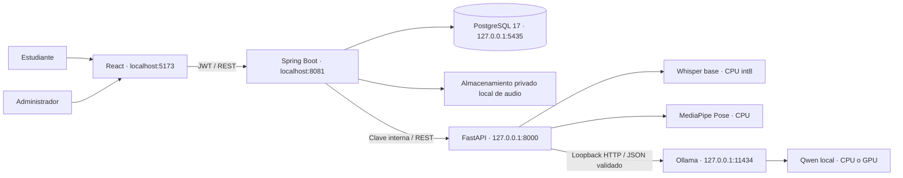
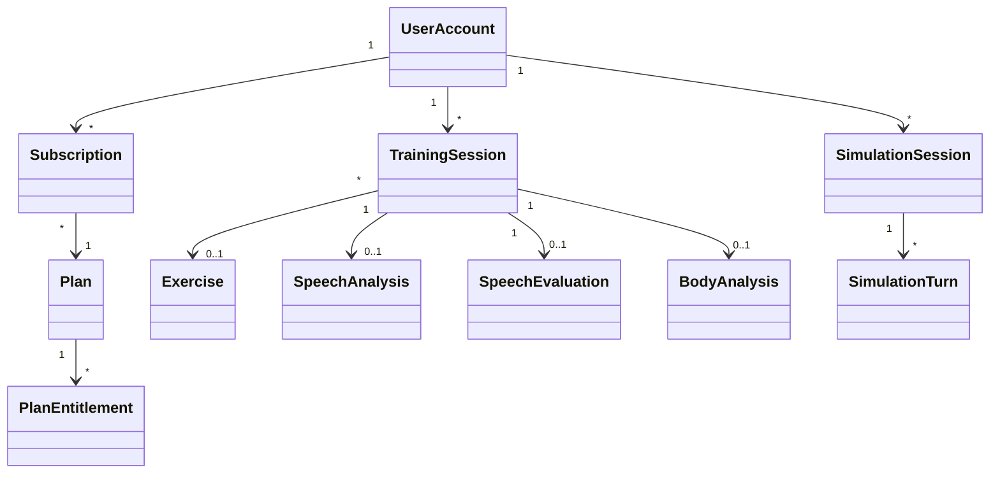
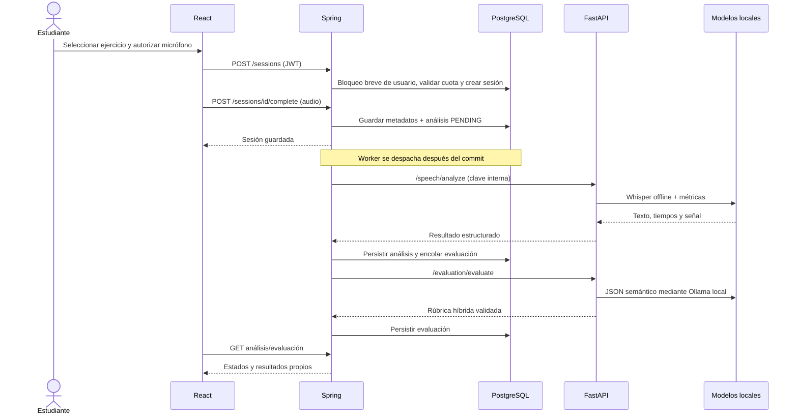

# Arquitectura de OratoriaAI — continuidad Software II

Se conserva React/TypeScript/Vite, Java 21/Spring Boot, PostgreSQL y FastAPI/Python.
La estructura heredada está versionada; no se sustituyeron frameworks ni se
reescribió el historial de los compañeros. La inferencia comercial se reemplazó por
adaptadores locales manteniendo los contratos usados por Java y React.

## C4: contexto y contenedores

Las flechas de inferencia no atraviesan Internet. Las descargas de pesos, paquetes y
runtime son operaciones explícitas de preparación. Las fuentes/iconos del frontend
se sirven desde el repositorio para evitar depender de Google Fonts durante el uso.

## Componentes y responsabilidades

| Capa | Responsabilidad |
|---|---|
| React features | Auth, catálogo/grabadora, sesiones/resultados, progreso, simulaciones, perfil, administración, corporal y planes |
| shared/services/api | Headers JWT, errores HTTP y descarga de blobs; una URL VITE_API_URL sin secretos |
| WorkspaceLayout / componentes compartidos | Nuevas pantallas con navegación y diseño existentes; sin duplicar servicios de negocio |
| Controllers Java | DTOs y validación, Principal autenticado, delegación a servicios |
| Services Java | Casos de uso, propiedad, cuotas, persistencia y orquestación de IA |
| Repositories / Entities | PostgreSQL y restricciones; nunca se devuelven entidades JPA por REST |
| Security | JWT/BCrypt, rol y enabled consultados en cada request, token_version para revocación |
| Flyway | Evolución aditiva del esquema; Hibernate valida, no modifica tablas automáticamente |
| FastAPI api / schemas | Contratos, autenticación interna, errores y validación |
| core/boundary | Autenticación previa al parsing, tamaño máximo y requestId seguro |
| services/speech / voice | Decodificación limitada, transcripción, métricas y NLP reutilizable |
| services/evaluation | Rúbrica propia, reglas y evaluación semántica estructurada local |
| services/simulation | Prompts por escenario, historial acotado, respuesta y feedback |
| services/pose | Observables 2D sin identidad ni emoción; fotogramas en memoria |
| infrastructure/ollama | HTTP exclusivamente de loopback, sin proxy/redirecciones, contexto/concurrencia limitados |

No se crean capas vacías ni un segundo backend. Los nombres de dominios y DTOs
históricos permanecen para no romper consumidores. Los nuevos servicios son
acotados; `SimulationService` conserva el formato heredado y requiere una futura
normalización de estilo si se amplía considerablemente.

## Modelo de datos / UML

Ver el diccionario y relaciones físicas en [BASE_DE_DATOS.md](BASE_DE_DATOS.md).
No se crean tablas duplicadas de transcripciones/recomendaciones: viven en los
agregados existentes. Los escenarios permanecen en un catálogo Java versionado.

## Secuencia de práctica

La red/modelo no mantiene abierta la transacción de finalización. Hay recuperación
de estados interrumpidos y reintentos explícitos, sin generar notas de relleno.

## Secuencia conversacional

Spring reserva un turno con bloqueo breve y clave idempotente; libera la transacción,
transcribe el audio y solicita la siguiente intervención local. Persiste texto y
respuesta en una transacción breve. Un fallo después de transcribir conserva ese
texto para que el reintento no duplique STT ni el turno. La evaluación final tiene su
propio estado y no altera las métricas históricas de prácticas.

## Planes, privacidad y fallos

Rol y plan son independientes. FREE admite cinco prácticas y una simulación creadas
por mes UTC; PREMIUM tiene esas cuotas ilimitadas. Se bloquea el usuario al comprobar
e insertar, evitando que dos solicitudes simultáneas gasten la última cuota a la vez.
Los derechos comerciales restantes están modelados; no hay cobros ni pasarela.

El borrado de medios usa una cola durable, no una eliminación de archivos dentro de
una transacción que pueda revertirse. No hay retención automática destructiva ni
acceso público a grabaciones. La recuperación de contraseña es administrativa local,
con verificación humana de identidad; no existe envío de correos.

Falta de pesos/runtime, motor ocupado o salida inválida se muestran como errores;
no se cambian silenciosamente a un proveedor remoto. La disponibilidad HTTP y la
disponibilidad del modelo se comprueban por separado. Las limitaciones científicas
se documentan en [ia/METRICAS_Y_RUBRICAS.md](ia/METRICAS_Y_RUBRICAS.md).
