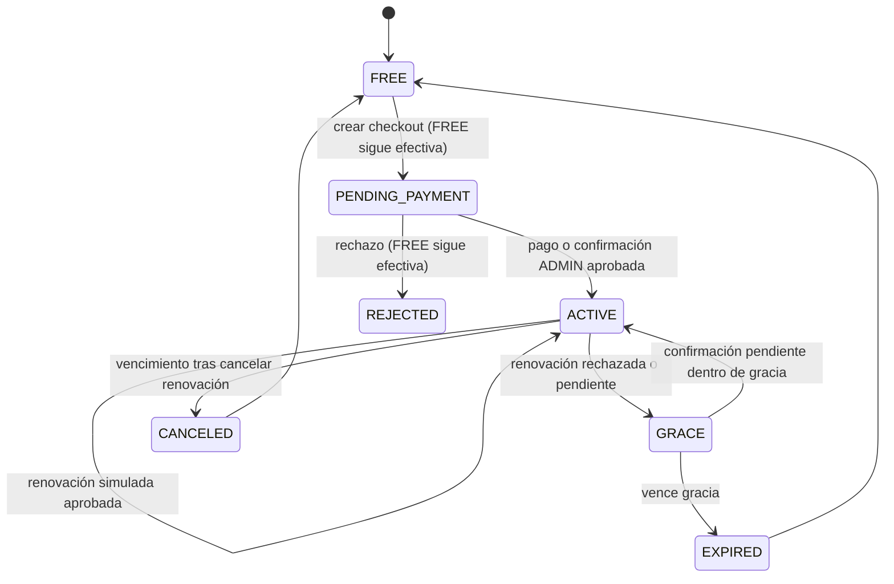

# Estados, renovaciones y tiempo

**Todos los pagos y renovaciones descritos son simulados; no existen cargos reales.**

`GRACE` es un estado efectivo expuesto por la API: la fila conserva ACTIVE y
`grace_until` mientras mantiene acceso temporal. No hay una segunda suscripción
activa de pago. PENDING_PAYMENT nunca se usa para conceder permisos. Al aprobar
checkout, la FREE anterior pasa a EXPIRED y la pendiente pasa a ACTIVE. El historial
de ambas se conserva. Al finalizar Premium se crea una nueva FREE activa.

## Periodos y zonas

Se persisten instantes TIMESTAMPTZ/Instant. El vencimiento mensual suma **un mes de
calendario en America/La_Paz**, no siempre 30 días. La interfaz formatea fechas en
esa zona. El precio es BOB/mes y se captura en cada orden desde el backend.

Por compatibilidad con el consumo existente, los límites de prácticas/simulaciones
siguen contando por **mes UTC**; la respuesta de consumo distingue quotaTimezone
UTC y billingTimezone America/La_Paz. El reloj de facturación no altera created_at,
grabaciones, estadísticas ni reinicia cuotas. La interfaz lo explica expresamente.

## Renovación y gracia

Las contrataciones aprobadas habilitan `auto_renew`. Al llegar al vencimiento,
el backend crea una orden RENEWAL única por suscripción y periodo; su escenario se
elige únicamente por configuración interna de la suscripción/operación ADMIN.
El usuario no puede mandar un resultado de renovación. APPROVED extiende un mes
desde el vencimiento anterior; REJECTED/PENDING conserva acceso hasta
vencimiento + BILLING_GRACE_DAYS (3 por defecto). Tras la gracia se pasa a FREE.
La confirmación de una renovación pendiente fuera de gracia se rechaza.

La conciliación ocurre en lectura de suscripción/identidad/permisos, inmediatamente
al avanzar el reloj, y mediante tarea periódica cada 60 segundos para vencimientos
del reloj real. No se procesan cobros comerciales. Si el simulador está deshabilitado,
una suscripción demo vencida expira sin invocar al proveedor.

El reloj de pruebas es **por usuario**, persiste en billing_demo_clocks y solo
avanza de 1 a 400 días por operación ADMIN en dev/test. No acepta una fecha de
producción ni modifica el reloj del sistema. Avances grandes concilian los meses
transcurridos con un límite de 24 ciclos por lectura; cada avance máximo de 400 días
queda por debajo de ese límite. No se ofrece control de tiempo a usuarios USER.
Si una inactividad excepcional supera el límite de conciliación, se expira el
acceso restante en lugar de conceder Premium con una fecha ya vencida.
El perfil demo permite checkout/confirmación pero no adelanto temporal.

## Cancelación

Cancelar desactiva auto_renew y audita RENEWAL_CANCELED. Si el periodo pagado no
terminó, Premium permanece hasta ends_at. No hay reembolso ficticio ni nuevo cargo.
Al vencer, queda CANCELED y se crea FREE. No se eliminan sesiones, audio, análisis,
progreso, identidad o historial de pagos. Con datos superiores al límite FREE,
la creación de nuevas prácticas se bloquea hasta el siguiente mes; no se borran
las anteriores para forzar el límite. Cancelar de nuevo no duplica eventos.

Las concesiones manuales ADMIN y el seed PREMIUM previo tienen demo_managed=false,
sin renovación ni expiración automática de pagos. Son distinguibles de una compra.
